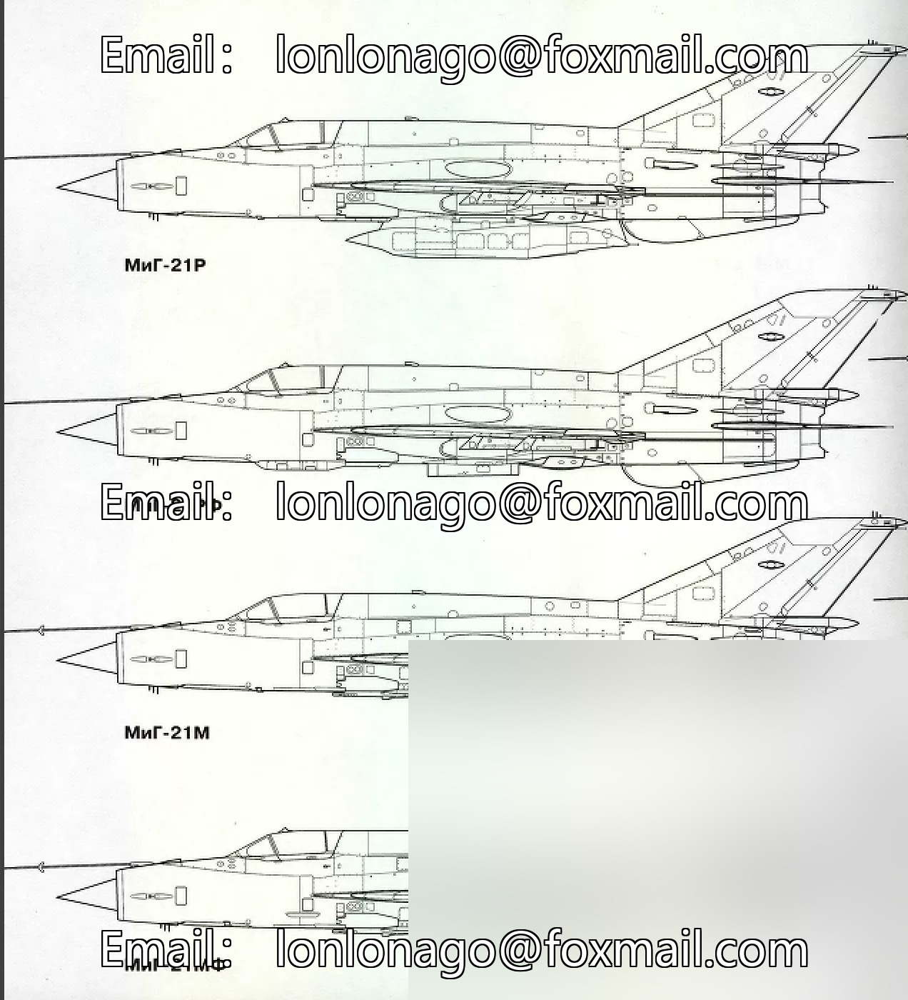
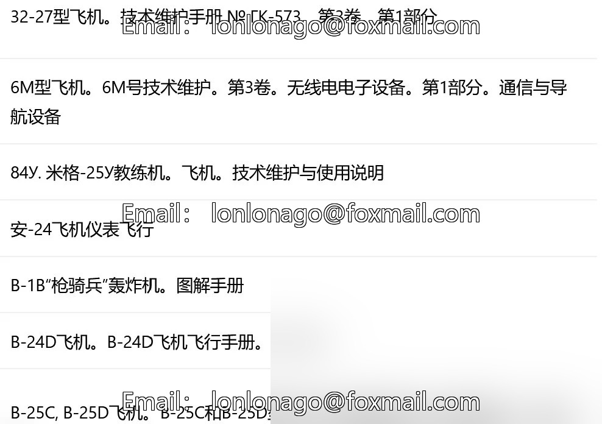
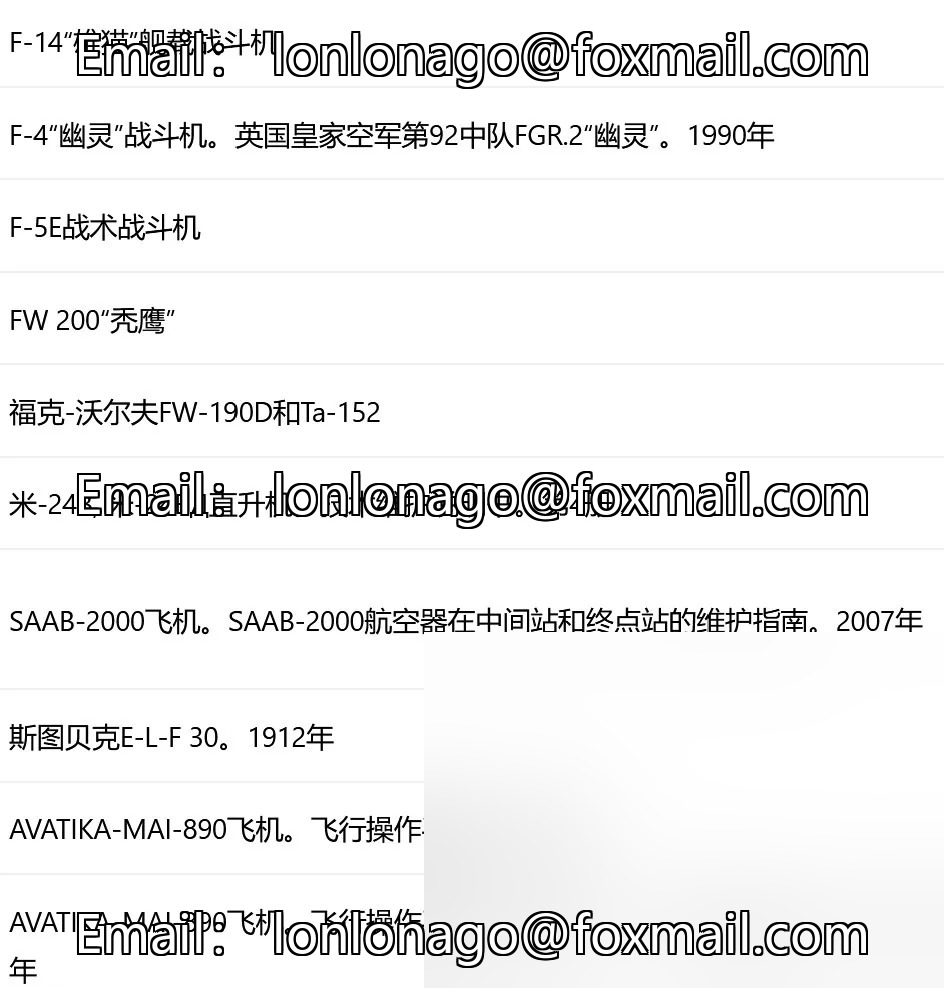
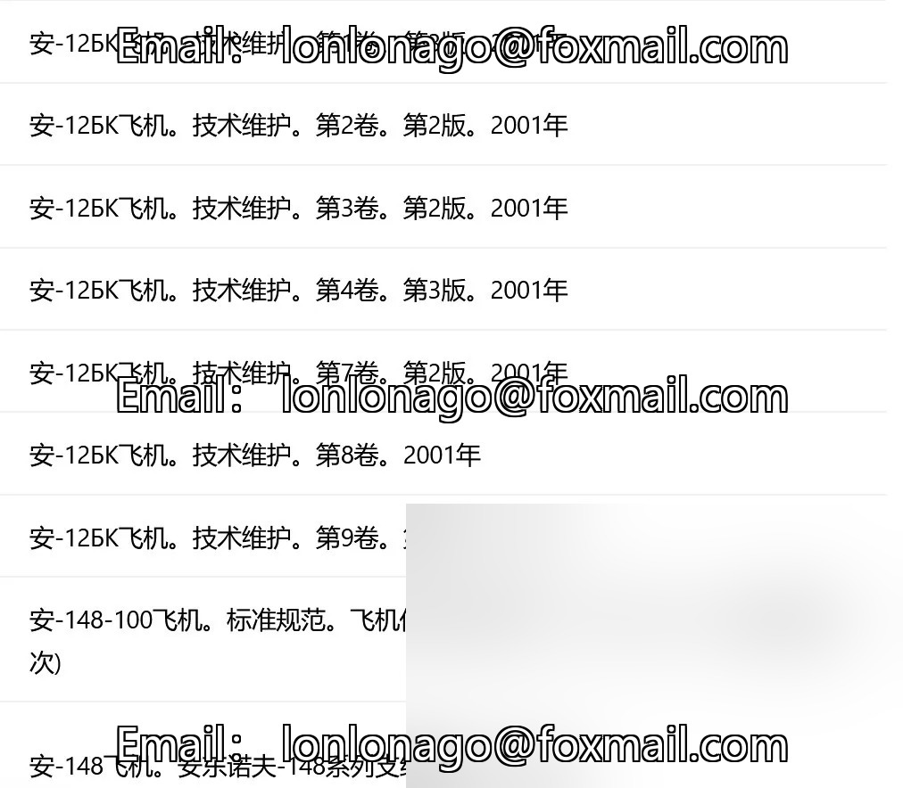

# Russian monograph--aircraft-related documents--584 documents, non-sale price requires procurement via private channel

## Body

Russian monographs -- aircraft-related documents -- 584 documents, with prices that are not for sale requiring private communication.
1. Document description: Covers classic models of major aircraft and helicopters of the Soviet/Russian Aircraft Design Bodies such as MiG (MiG), Su (Su), An (An), Il (Il), Tu (Tu), Yak (Yak), and Mi (Mi), as well as technical materials for European/US aircraft such as Boeing (Boeing) and Cessna (Cessna).
2. Professional type:
RLE: Flight manual
TO / TOIEE: Technical maintenance manual / technical maintenance and usage instructions
Technical description: Technical specification

Operating instructions: User manual
Flight/technical operation guide: Guidance for flight/technical operation
Parts catalog: Parts directory
Illustrated book: Graphic manual (including drawings and photos)

The documents cover Soviet/Russian aircraft and helicopter design bureau types such as MiG, Su, An, Il, Tu, Yak, Mi, plus US and European aircraft technical materials; they include manuals, maintenance manuals, technical descriptions, operating guides, catalogs and illustrated manuals.

<!-- AI_ENRICHED -->

## Images

## Payment

Here is a pay link on Stripe ( https://buy.stripe.com/3cs8yP7sY87d0vu9AB ). Please contact me lonlonago@foxmail.com after funding $89, and I will send you a complete data files , thank you!

